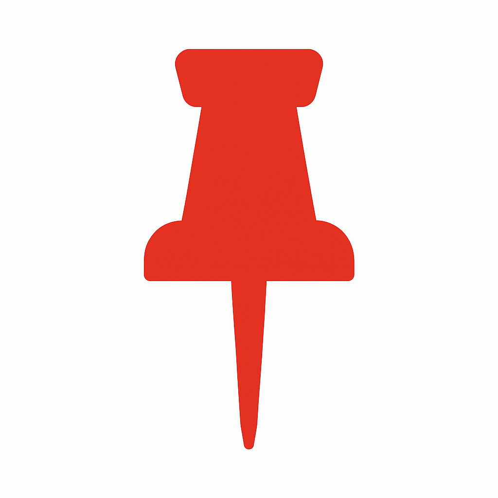

# YTBookmarks

**A Chrome extension that pins labeled bookmarks onto YouTube's progress bar, so you can jump back to key moments in long videos.**

<br clear="left">

**[➜ Install from the Chrome Web Store](https://chromewebstore.google.com/detail/ytbookmarks/jkiapphfienejigejenmajblkimmclcl)**

<!-- Add a screenshot or GIF here: pins on the progress bar + the bookmark sidebar.
 -->

## Why it exists

Finding a specific moment again in a long lecture, tutorial, or stream means scrubbing through the timeline. YTBookmarks lets you mark that moment with one click. You see the pin right on the video's timeline.

## Key features

- **One-click bookmarks.** A bookmark button sits in YouTube's player controls. Click it to save the current timestamp.
- **Labeled pins on the timeline.** Each bookmark appears as a pin on the progress bar with its label. Labels that would overlap stack automatically.
- **Jump back instantly.** A sidebar lists your bookmarks in time order. Click one to seek straight to it.
- **Quick editing, with undo.** Rename a bookmark inline, right-click its timestamp to change the time, or delete it. If you delete by mistake, **Undo** brings it back (this works for "clear all" too).
- **Saved per video, portable.** Bookmarks are stored in your browser for each video. Right-click the extension icon to export or import them as a JSON file.

<details>
<summary>More details</summary>

- Search appears once a video has more than 5 bookmarks.
- You can drag the sidebar anywhere. Its position is remembered for each video.
- An eye button hides or shows all of the extension's UI.
- Pins change appearance once playback passes them.
- The extension works with YouTube's in-page navigation, so it resets correctly when you move to a new video.

</details>

## Tech stack

- **JavaScript (ES modules)**, Chrome Extension **Manifest V3** (content script + service worker)
- **SCSS** for styling, compiled with Sass
- **esbuild** for bundling
- Browser `localStorage` for persistence. No backend and no account.

## Install

**Chrome Web Store (recommended):** [YTBookmarks](https://chromewebstore.google.com/detail/ytbookmarks/jkiapphfienejigejenmajblkimmclcl), then click **Add to Chrome**.

**From source (load unpacked):** The built files (`content.js`, `styles.css`) are already in the repo, so you can load it directly:

1. Clone or download this repo.
2. Open `chrome://extensions` and turn on **Developer mode**.
3. Click **Load unpacked** and select the project folder.
4. Open any YouTube video. The bookmark button appears in the player controls.

## Development

```bash
npm install
npm run build   # bundle src/js → content.js and compile src/styles → styles.css
npm run watch   # rebuild on change
```

After rebuilding, click **Reload** on the extension in `chrome://extensions`.

## Project structure

```
manifest.json        # Extension config (MV3)
background.js        # Right-click menu: Export / Import
src/js/              # Source: pins, sidebar, bookmarks, state, import/export
src/styles/          # SCSS source
content.js, styles.css   # Build output loaded by Chrome
```
