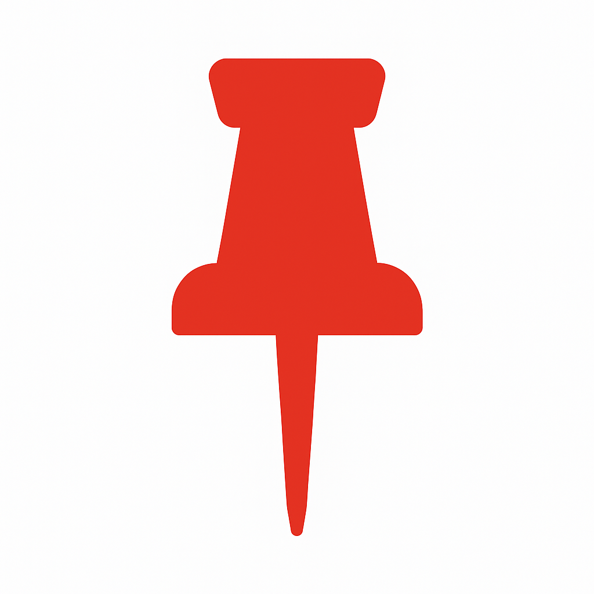
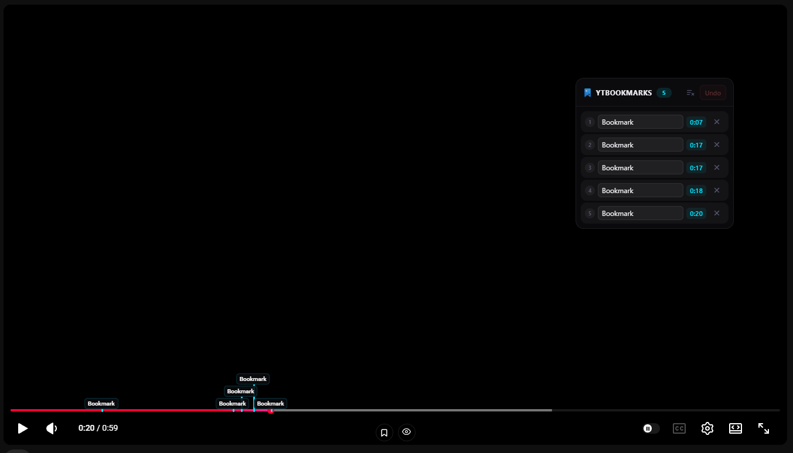

# YTBookmarks

**A Chrome extension that pins labeled bookmarks onto YouTube's progress bar, so you can jump back to key moments in long videos.**

<br clear="left">

**[➜ Live on the Chrome Web Store](https://chromewebstore.google.com/detail/ytbookmarks/jkiapphfienejigejenmajblkimmclcl)** · JavaScript · Chrome Manifest V3 · SCSS · esbuild



*Labeled pins on the progress bar (overlapping labels stack automatically) and the bookmark sidebar.*

## Why I built it

I learn a lot from long YouTube videos: lectures, coding tutorials, multi-hour streams. The frustrating part was finding a specific moment again. I'd remember "the part where they explain X," then scrub back and forth along the timeline trying to land on it. YouTube's chapters only exist when the creator adds them, and they mark the creator's important moments, not mine.

I wanted my own chapters: click once to mark a moment, give it a name, and see it on the timeline from then on. Nothing I found did that cleanly, so I built it. It was my first Chrome extension, and I took it all the way to a published listing on the Chrome Web Store.

## What it does

- **One-click bookmarks.** A button in YouTube's player controls saves the current timestamp (and pauses the video so you can name it).
- **Labeled pins on the timeline.** Each bookmark shows as a pin on the progress bar. Labels that would overlap stack automatically.
- **Jump back instantly.** A sidebar lists your bookmarks in time order. Click one to seek to it.
- **Quick editing, with undo.** Rename inline, right-click a timestamp to change it, delete, and undo mistakes (including "clear all").
- **Saved per video, portable.** Bookmarks are stored in your browser for each video. Right-click the extension icon to export or import them as JSON.

<details>
<summary>More details</summary>

- Search appears once a video has more than 5 bookmarks.
- The sidebar can be dragged anywhere, and its position is remembered for each video.
- An eye button hides or shows all of the extension's UI.
- Pins change appearance once playback passes them.
- The sidebar hides when you scroll the player out of view.

</details>

## How it works

The hard part of this project was building UI *inside someone else's app*. I don't control YouTube's page, it changes without warning, and it never fully reloads.

- **Single-page navigation.** YouTube swaps videos without a page load, so a content script that only runs once would show the previous video's pins. The extension listens for YouTube's own `yt-navigate-start` / `yt-navigate-finish` events, tears down its UI, and rebuilds it for the new video.
- **Waiting for the player.** The video element and progress bar appear at unpredictable times. The script waits until the player, `<video>` and progress bar all exist before it renders anything.
- **Label collision layout.** Pins close together would have overlapping labels. Pins are placed by `time / duration`, and each label is put on the lowest "row" where it doesn't overlap a label already there, a small interval-packing algorithm. Labels near either edge are anchored so they don't spill off the bar.
- **Reading layout, then writing it.** Labels are measured inside `requestAnimationFrame` before they're positioned, so the browser isn't forced into extra layout work while rendering.
- **Clean, modular source.** About 1,000 lines split into modules (state, pins, sidebar, bookmarks, import/export), bundled with esbuild, with SCSS partials compiled by Sass.
- **Minimal permissions.** It only asks for `contextMenus` (for export/import) and runs on YouTube. No account, no server, no tracking. Data stays in your browser.

## What I learned

- **Shipping is its own skill.** Getting from "works on my machine" to the Chrome Web Store meant writing a store listing, packaging a clean upload (there's an `npm run zip` script for it), handling review, and releasing updates. It's at version 2.4.
- **Building on a platform you don't own.** YouTube can change its markup at any time, so I had to rely on stable hooks (its navigation events, player element IDs) and fail safely when they're missing.
- **Single-page apps change how you think about lifecycle.** "Page loaded" doesn't mean "new content." I had to treat setup and cleanup as a pair and run them on every navigation.
- **Structure pays off quickly.** The first version was one big script. Splitting it into modules with a central state manager made features like undo and import/export much easier to add.

**What I'd improve next:** sync bookmarks across devices with `chrome.storage.sync`, remove per-render `timeupdate` listeners so long sessions stay light, and add tests for the label-layout logic.

## Tech stack

- **JavaScript (ES modules)**, Chrome Extension **Manifest V3** (content script + service worker)
- **SCSS** compiled with Sass
- **esbuild** for bundling
- Browser `localStorage` for persistence. No backend, no account.

## Install

**Chrome Web Store (recommended):** [YTBookmarks](https://chromewebstore.google.com/detail/ytbookmarks/jkiapphfienejigejenmajblkimmclcl), then **Add to Chrome**.

**From source:**

1. Clone or download this repo.
2. Run `npm install` and `npm run build`. The extension is built into `dist/`.
3. Open `chrome://extensions` and turn on **Developer mode**.
4. Click **Load unpacked** and select the `dist` folder.
5. Open any YouTube video. The bookmark button appears in the player controls.

## Development

```bash
npm install
npm run build   # build the extension into dist/: bundle src/js, compile src/styles, copy static files
npm run watch   # rebuild on change
npm run zip     # build, then package dist/ for a Chrome Web Store upload
```

After rebuilding, click **Reload** on the extension in `chrome://extensions`.

## Project structure

```
manifest.json            # Extension config (MV3)
background.js            # Right-click menu: Export / Import
popup.html, popup.css    # Toolbar popup
scripts/copy-static.mjs  # Copies static files into dist/
src/js/
  content.js             # Entry point: page lifecycle, YouTube navigation events
  state.js               # Central state + persistence
  pins.js                # Pins and label layout on the progress bar
  sidebar.js             # Bookmark list, editing, search, drag
  bookmarks.js           # Add / edit / delete / undo
  import-export.js       # JSON export and import
src/styles/              # SCSS partials
dist/                    # Build output, loaded by Chrome (not committed)
```

## About

Built by **Tan Thai**. | [LinkedIn](https://linkedin.com/in/tanthai028) | [GitHub](https://github.com/tanthai028)

Other projects: [yt-transcriber](https://github.com/tanthai028/yt-transcriber) (transcripts for any YouTube video) · [Stride](https://github.com/tanthai028/stride-desktop-app) · [RJ Job Tracker](https://github.com/tanthai028/RJTracker)
